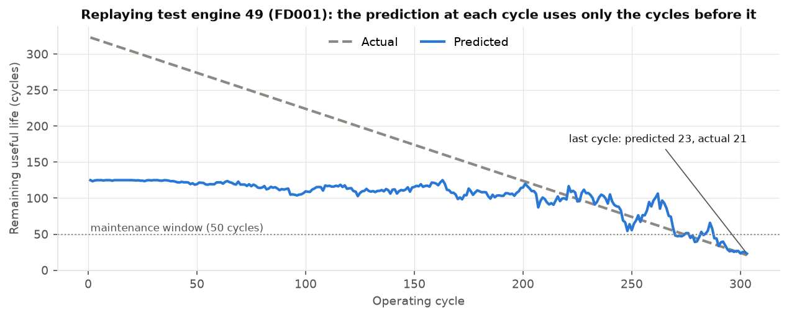
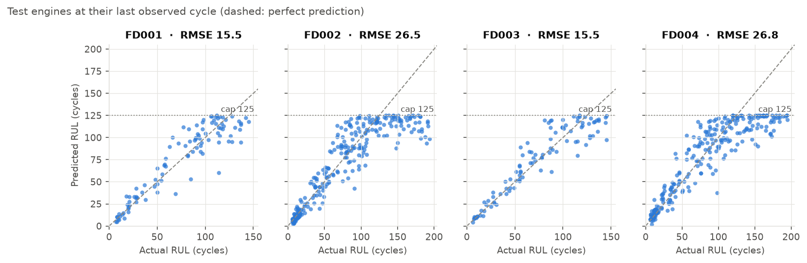
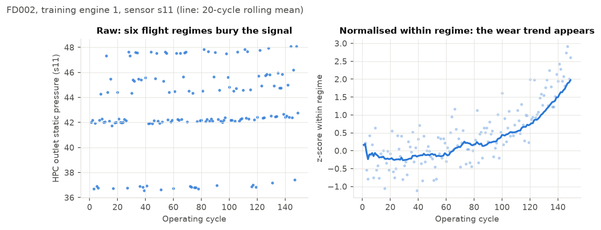

# Turbofan Engine Remaining Useful Life Prediction

[](https://github.com/NawafK70/predictive-maintenance/actions/workflows/ci.yml)


This project predicts how many operating cycles a turbofan engine has left before it fails, using its sensor history. The model is trained on NASA's **C-MAPSS** run-to-failure dataset. It is served through a **FastAPI** service, with a **Streamlit** demo, data-drift monitoring, a Docker image and CI.



## Highlights

- **Accurate where it matters:** within 50 cycles of failure, the error is **5–10 cycles** on all four sub-datasets. That is the window where maintenance gets scheduled.
- **Handles multiple flight regimes:** sensors are normalised per operating condition. Without this, regime changes bury the degradation signal (see [Approach](#approach)).
- **No leakage:** cross-validation is grouped by engine, and features use only past cycles. Tests check both.
- **Reproducible:**
  - Every experiment is defined in a TOML config.
  - Each saved model records its config, git commit, library versions and metrics.
- **Ready to deploy:** the trained pipeline takes raw sensor readings and computes its own features, so the API can't drift from training. It ships with a Docker image, a drift monitor and CI.

## Results

All results use NASA's official test set, scored at each engine's last observed cycle. RMSE is in cycles; lower is better.

| Subset | Conditions · fault modes | Test RMSE | RMSE vs capped truth | RMSE, last 50 cycles | Within ±15 cycles |
|---|---|---|---|---|---|
| FD001 | 1 · 1 | 15.5 | 14.2 | 6.7 | 71% |
| FD002 | 6 · 1 | 26.5 | 14.4 | 7.9 | 59% |
| FD003 | 1 · 2 | 15.5 | 13.6 | 4.8 | 73% |
| FD004 | 6 · 2 | 26.8 | 15.0 | 9.7 | 55% |



- **Why FD002/FD004 test RMSE is higher:** the target is capped at 125 cycles, because a healthy engine shows no sign of how long it will last. 22–27% of FD002/FD004 test engines have more than 125 cycles left. Against capped truth, all four subsets score 14–15 RMSE, in line with cross-validation.
- **Model choice:** XGBoost won cross-validation on every subset, ahead of random forest and HistGradientBoosting (within about 0.5 RMSE) and a Ridge baseline (4–6 RMSE worse).
- **Full report:** [reports/results.md](reports/results.md) has the per-model CV scores, NASA scores and late-prediction rates.

## Approach

**Data.** C-MAPSS simulates fleets of engines run to failure. Each row is one engine cycle with 3 operational settings and 21 sensors. FD002 and FD004 mix six flight regimes, and FD003 and FD004 have two fault modes.

**Target.** RUL is the number of cycles until failure, capped at 125. This is the standard piecewise-linear target, because early-life RUL can't be inferred.

**Features.** All feature steps live inside the scikit-learn pipeline:
- Assign each cycle to an operating condition with KMeans on the settings.
- Standardise each sensor within its condition.
- Drop constant sensors.
- Per engine, compute rolling means over 5 and 20 cycles and a rolling slope over 20 cycles.
- Add engine age.



**Validation.** Model selection uses 5-fold `GroupKFold` by engine. Rows from one engine are highly correlated, so a random split would leak. The test set is touched once, after the best model is chosen.

**Metrics.** The report includes RMSE, RMSE near failure and the NASA PHM08 score, which penalises late predictions more than early ones.

## Quickstart

```bash
pip install -e ".[dev]"        # package + test, lint, demo and report extras
rul-data                       # download C-MAPSS (~12 MB) and summarise it
rul-train --subset all         # train + evaluate all four subsets (~5–10 min)
rul-report                     # regenerate reports/results.md and figures
pytest                         # tests
```

## Usage

**Demo.** Pick a held-out test engine, drag a slider through its life, and watch the predicted RUL against the truth, with a maintenance status and the key sensors.

```bash
streamlit run demo/app.py
```

**REST API.** Interactive docs are at http://localhost:8000/docs.

```bash
uvicorn turbofan_rul.api:app
```

| Endpoint | Purpose |
|---|---|
| `POST /predict/{subset}` | Body: `{"cycles": [{"cycle": 1, "settings": [3 floats], "sensors": [21 floats]}, ...]}`. Returns `rul_cycles`, `at_cap` (no measurable degradation yet) and the model version. |
| `GET /models` | Loaded models and their test metrics |
| `GET /health` | Liveness check |

**Docker.** Requires trained models in `models/`.

```bash
docker build -t turbofan-rul .
docker run -p 8000:8000 turbofan-rul
```

**Drift monitoring.** The API logs the latest reading of each request. This command compares those readings with the training data (PSI per sensor). It exits with code 1 on significant drift, so a scheduler can trigger retraining.

```bash
rul-monitor --subset FD001
```

## Experiments

Hyperparameters, candidate models, feature windows, the RUL cap and CV folds all live in [configs/default.toml](configs/default.toml). To run a variant:

```bash
rul-train --subset FD004 --config configs/my_experiment.toml
```

Each run writes these files to `models/<subset>/`:
- `model.joblib`
- `metadata.json`: metrics, CV comparison, the full config, git commit and library versions
- `reference.csv`: the drift baseline

## Project structure

```
configs/default.toml        experiment configuration
src/turbofan_rul/
  data.py                   download, load, RUL labels
  features.py               regime normalisation + causal rolling features (sklearn transformer)
  models.py                 model registry, pipeline construction
  train.py                  CV model selection, test evaluation, artefacts       (rul-train)
  evaluate.py               RMSE, NASA score, near-failure metrics
  inference.py              RULPredictor: shared by API, demo and report
  report.py                 results table + figures                              (rul-report)
  api.py                    FastAPI service
  monitor.py                PSI drift check                                      (rul-monitor)
  settings.py               paths and environment overrides
demo/app.py                 Streamlit demo
reports/                    generated results and figures
tests/                      unit, inference and API tests
```

## Limitations and next steps

- **Simulated data.** Real fleets add maintenance events, sensor faults and censored histories.
- **Point estimates.** The next step is prediction intervals (quantile regression or conformal prediction), so maintenance can plan around a range rather than one number.
- **Sequence models.** A 1D-CNN or LSTM over cycle windows typically reaches about 11–13 RMSE on FD001.

## Data

A. Saxena, K. Goebel, D. Simon and N. Eklund, *Damage Propagation Modeling for Aircraft Engine Run-to-Failure Simulation*, PHM 2008. The dataset comes from the [NASA Prognostics Data Repository](https://www.nasa.gov/intelligent-systems-division/discovery-and-systems-health/pcoe/pcoe-data-set-repository/).
